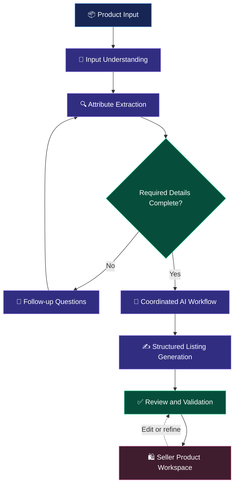

markdown
<div align="center">

# ✨ OmniList AI

### MULTIMODAL INTELLIGENCE. AUTONOMOUS WORKFLOWS. SMARTER COMMERCE.

**An AI-powered, multi-agent engine for intelligent e-commerce listing generation.**

Transform raw product information into structured, informative, seller-ready listings through multimodal understanding, coordinated AI workflows, and intelligent attribute extraction.

<br/>

[](https://github.com/returnzerovicky/OmniList-AI)
[](https://react.dev/)
[](https://vite.dev/)
[](https://developer.mozilla.org/en-US/docs/Web/JavaScript)

<br/>

**[Explore Repository](https://github.com/returnzerovicky/OmniList-AI)**
&nbsp; • &nbsp;
**[Report an Issue](https://github.com/returnzerovicky/OmniList-AI/issues)**

</div>

---

## 🧠 The Vision

Creating high-quality e-commerce listings is often repetitive, time-consuming, and dependent on manually organizing product information.

**OmniList AI** explores how multimodal AI and multi-agent workflows can simplify this process.

The platform is designed to interpret product information, identify relevant attributes, generate structured listing content, and integrate the results into a seller-focused product management experience.

Rather than treating listing creation as a single text-generation task, OmniList AI approaches it as a coordinated workflow involving information understanding, extraction, generation, validation, and human review.

> **Our goal:** bridge the gap between unstructured product information and structured, marketplace-ready content.

## ⚡ Key Capabilities

<table>
<tr>
<td width="50%" valign="top">

### 🧠 Multimodal AI

Process product-related inputs and derive meaningful information to support automated listing creation.

### 🤖 Multi-Agent Workflows

Organize listing-generation tasks into coordinated stages for information extraction, content preparation, and missing-detail handling.

### 🔎 Intelligent Attribute Extraction

Identify and structure relevant product information into fields that can be reviewed and used in seller workflows.

</td>
<td width="50%" valign="top">

### ✍️ AI-Assisted Content Generation

Transform product details into structured listing information, including product titles, descriptions, and attributes.

### 🔄 Context-Aware Follow-Ups

Handle incomplete product information through follow-up questions designed to collect missing details.

### 🛍️ Seller-Focused Workspace

Connect AI-assisted listing creation with product creation, editing, catalog search, category filtering, and inventory-oriented workflows.

</td>
</tr>
</table>

## 🏗️ System Workflow

The following diagram illustrates the intended end-to-end listing workflow.



**Workflow principles**

- **Understand before generating:** extract useful product information before constructing the final listing.
- **Handle missing context:** request additional details when necessary.
- **Structure the output:** organize information for downstream product-management workflows.
- **Keep humans in control:** allow generated content to be reviewed and refined.

*The diagram represents the workflow concept; exact agent boundaries and execution details depend on the implementation.*

## 🛠️ Technology Stack

<div align="center">

| Category | Technologies |
|:---|:---|
| Frontend | React |
| Build Tooling | Vite |
| Programming Language | JavaScript |
| AI Approach | Multimodal AI, Multi-Agent Workflows |
| Application Domain | E-Commerce, Product Information Extraction |
| Core Workflow | Attribute Extraction, Listing Generation, Human Review |

</div>

> Additional frameworks, model names, backend services, and databases should be documented here once confirmed against the project source code.

## 🎯 The Problem We Address

| Traditional Listing Creation | OmniList AI Approach |
|:---|:---|
| Manual product-detail organization | AI-assisted information extraction |
| Repetitive content preparation | Structured listing-generation workflows |
| Missing product attributes | Follow-up handling for incomplete information |
| Disconnected listing activities | Integrated seller-facing product workflows |
| Manual review from the beginning | Generated content prepared for review and refinement |

These are the project's design goals, not claims of measured performance improvements.

## 💡 What Makes OmniList AI Interesting?

**1. Workflow-oriented AI engineering**

The project approaches product listing as a sequence of related tasks rather than relying solely on an isolated generation prompt.

**2. Structured information, not just text**

The focus is on extracting meaningful product attributes and organizing them for practical use.

**3. AI integrated with a real application domain**

The AI workflow is connected to e-commerce listing and product-management needs.

**4. Human review as part of the process**

Generated information remains reviewable, allowing sellers to refine product details before using them.

**5. Extensible design direction**

The project can evolve with additional input modalities, validation mechanisms, evaluation datasets, and AI service integrations.

## 🚀 Getting Started

### Prerequisites

- Node.js
- npm
- Git

### Clone the repository

```bash
git clone https://github.com/returnzerovicky/OmniList-AI.git
cd OmniList-AI
```

### Install dependencies

```bash
npm install
```

### Start the development server

```bash
npm run dev
```

### Build for production

```bash
npm run build
```

**Note:** These commands assume the repository contains a standard React + Vite application with the corresponding npm scripts. Ensure the application source and `package.json` are committed before presenting these instructions as verified.

## 🗺️ Future Development

Potential directions for further development include:

- [ ] Reproducible evaluation of product-attribute extraction quality
- [ ] Automated checks for missing, conflicting, and invalid product details
- [ ] Quantitative evaluation of listing completeness and manual correction effort
- [ ] Expanded support for product input modalities
- [ ] Automated tests for listing workflows and AI-service integration
- [ ] Clear documentation of agent responsibilities and model configurations
- [ ] Demonstrations of the complete listing-generation workflow

## 🎓 About the Project

OmniList AI is a final-year project exploring the application of multimodal AI and multi-agent workflows to e-commerce product listing generation.

It brings together AI-oriented problem solving, structured information processing, and seller-focused application design.

## 👨‍💻 Author

<div align="center">

### Banoth Vikas

Computer Science and Engineering  
National Institute of Technology, Silchar

[](https://github.com/returnzerovicky)
[](https://returnzerovicky.github.io/My-Portfolio/)
[](https://www.linkedin.com/in/banoth-vikas-830b2428a)

</div>

---

<div align="center">

**OMNILIST AI**

*From product information to intelligent listings.*

Built with curiosity, experimentation, and a passion for applied AI.

</div>
```
